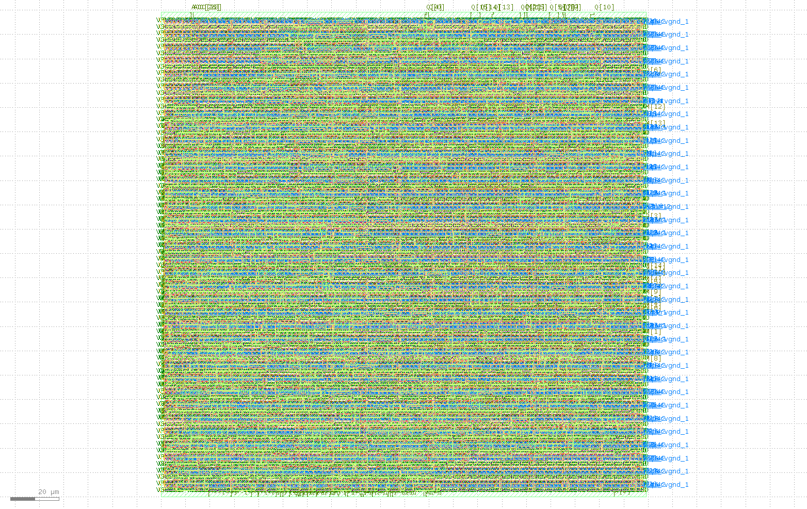
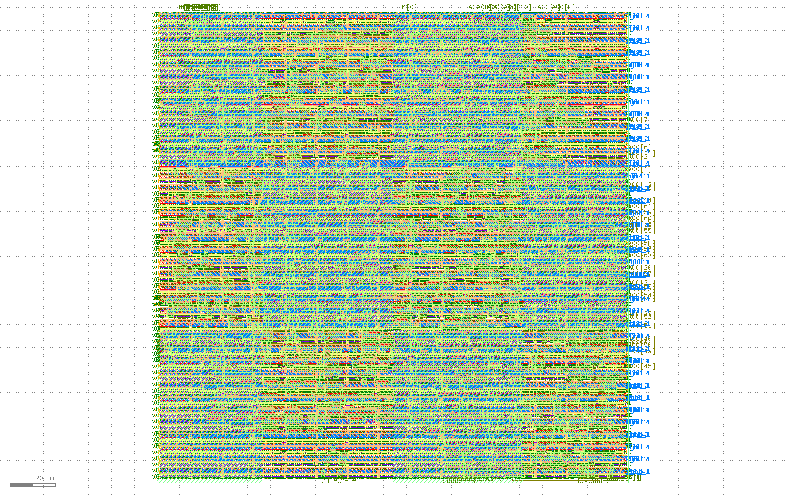

# 16-bit Signed MAC Accelerator — RTL to GDSII

A comparative RTL-to-GDSII implementation of conventional and pipelined 16-bit signed Multiply-Accumulate (MAC) architectures using the SKY130HD standard-cell platform.

The project covers RTL design, functional verification, logic synthesis, physical implementation, timing analysis, and final layout verification using open-source EDA tools.

## 1. Project Overview

A Multiply-Accumulate (MAC) unit performs multiplication followed by accumulation:

\[
ACC_{next} = ACC + (A \times B)
\]

This project implements two architectures:

- **Conventional MAC:** The multiplier output is directly connected to the accumulator.
- **Pipelined MAC:** An additional product register is introduced between the multiplier and accumulator.

Both architectures use a signed Radix-4 Booth multiplier, a Carry-Save Adder (CSA) reduction tree, and a final carry-propagate adder.

The objective is to compare their area, timing, power estimates, and physical implementation results.

## 2. Design Specifications

| Parameter | Specification |
|---|---|
| Operand width | 16 bits |
| Multiplier output width | 32 bits |
| Accumulator width | 64 bits |
| Number representation | Signed two's complement |
| Multiplication algorithm | Radix-4 Booth encoding |
| Partial-product reduction | Carry-Save Adder tree |
| Final multiplier adder | 32-bit Carry-Propagate Adder |
| MAC architectures | Conventional and pipelined |
| Target PDK | SKY130HD |
| Synthesis | Yosys |
| Physical implementation | OpenROAD |
| Timing analysis | OpenSTA |
| Layout inspection | KLayout |

## 3. Architecture

### 3.1 Radix-4 Booth Multiplier

The multiplier uses Radix-4 Booth encoding to reduce the number of partial products.

For 16-bit operands, the implementation generates eight partial products. The Booth encoding selects among:

- 0
- +A
- +2A
- -A
- -2A

The generated partial products are reduced using a Carry-Save Adder tree.

### 3.2 Carry-Save Adder Tree

The CSA tree reduces multiple partial-product operands into two final operands without propagating carry across the entire word at each compression stage.

The final two operands are added using a 32-bit carry-propagate adder to produce the multiplication result.

### 3.3 Conventional MAC

In the conventional architecture, the 32-bit multiplier output is connected directly to the 64-bit accumulator datapath.

### 3.4 Pipelined MAC

The pipelined architecture introduces:

- A 32-bit product register.
- A `product_valid` control bit.
- A separate accumulation stage.

This adds one cycle between product acceptance and accumulation. The pipeline supports consecutive enabled operations.

## 4. RTL-to-GDSII Implementation Flow

The design was implemented using the SKY130HD platform and OpenROAD-flow-scripts.

The completed implementation stages are:

1. RTL design and functional verification.
2. RTL synthesis using Yosys.
3. Floorplanning.
4. Power distribution network generation.
5. Global placement and detailed placement.
6. Clock tree synthesis.
7. Global routing.
8. Detailed routing.
9. Filler-cell insertion and final design processing.
10. Final GDSII generation.
11. DRC, LVS, and LEC verification.

## 5. Physical Design Results

Both architectures completed the physical implementation flow.

### 5.1 PPA Comparison

| Metric | Conventional MAC | Pipelined MAC |
|---|---:|---:|
| Final design area | 16,675 µm² | 18,080 µm² |
| Placement utilization | 44% | 43% |
| Sequential cells | 64 | 97 |
| Reported Fmax | 233.94 MHz | 259.02 MHz |
| Worst setup slack | +28.84 ns | +32.06 ns |
| Worst setup arrival | 21.40 ns | 18.19 ns |
| Reported total power | 0.372 mW | 0.344 mW |

### 5.2 Comparative Analysis

The pipelined architecture demonstrates:

- Approximately **8.42% higher final design area**.
- Approximately **10.7% higher reported maximum frequency**.
- Improved reported setup slack.
- A higher sequential-cell count due to the additional pipeline registers.

The results illustrate the area-versus-timing trade-off introduced by pipelining.

### 5.3 Timing Constraints and Interpretation

The SDC configuration uses:

- Clock period: 50 ns (20 MHz characterization target).
- Input delay: 10 ns.
- Output delay: 10 ns.
- Virtual clock constraints.

The reported Fmax values are estimates derived from the implementation timing reports. They are not measured silicon operating frequencies.

### 5.4 Power Analysis Caveat

The reported total power values are implementation-flow estimates.

A workload-specific switching-activity file (SAIF/VCD) was not established for this comparison. Therefore, the lower reported power of the pipelined design should not be interpreted as proof of lower real-world dynamic power.

## 6. Final Verification

| Verification | Conventional MAC | Pipelined MAC |
|---|---|---|
| Functional simulation | Pass | Pass |
| OpenROAD LEC | Pass | Pass |
| Final KLayout DRC | 0 violations | 0 violations |
| LVS | Pass | Pass |

The LVS checks completed with matching netlists.

The final verification logs, reports, and metrics are archived under:

- `results/final_verification/conventional/`
- `results/final_verification/pipelined/`

**Verification scope:** These results represent checks performed using the configured open-source EDA flow. They should not be interpreted as foundry signoff or silicon validation.

## 7. Final GDSII Layouts

The following images show the final layouts of both MAC architectures.

### Conventional MAC



### Pipelined MAC



The layouts were inspected using KLayout after final GDSII generation.

## 8. Repository Structure

```text
mac_accelerator/
│
├── rtl/
│   ├── mac/
│   │   ├── mac_16bit.v
│   │   └── mac_16bit_pipelined.v
│   │
│   └── multiplier/
│       ├── booth_multiplier_16bit.v
│       ├── csa_3to2_32bit.v
│       └── final_cpa_32bit.v
│
├── verification/
│   └── testbenches/
│       ├── tb_booth_multiplier_16bit.v
│       ├── tb_mac_16bit.v
│       └── tb_mac_16bit_pipelined.v
│
├── constraints/
│   ├── mac_16bit.sdc
│   └── mac_16bit_pipelined.sdc
│
├── physical_design/
│   └── config/
│       ├── mac_16bit/
│       │   └── config.mk
│       └── mac_16bit_pipelined/
│           └── config.mk
│
├── results/
│   ├── synthesis/
│   ├── floorplan/
│   ├── placement/
│   ├── cts/
│   ├── routing/
│   └── final_verification/
│
├── images/
│   ├── mac_16bit_conventional_gds.png
│   └── mac_16bit_pipelined_gds.png
│
├── README.md
└── .gitignore
```

The `results/` directory contains selected synthesis reports, physical-design metrics, stage logs, and final verification evidence. Large intermediate databases and generated implementation files are excluded from version control.

## 9. Tools and Technologies

| Tool / Technology | Purpose |
|---|---|
| Verilog | RTL design |
| Icarus Verilog | Functional simulation |
| Yosys | Logic synthesis |
| SKY130HD | Standard-cell platform |
| OpenROAD | Physical implementation |
| OpenSTA | Static timing analysis |
| KLayout | GDSII inspection and DRC |
| Netgen | LVS |
| Docker | EDA environment |

## 10. Project Outcomes

This project demonstrates an end-to-end implementation and comparison of two signed MAC architectures.

Key outcomes:

- Modular 16-bit signed Radix-4 Booth multiplier.
- CSA-based partial-product reduction.
- Conventional and pipelined 64-bit MAC architectures.
- Functional verification of both implementations.
- Completed SKY130HD physical-design flow.
- Final GDSII generation and layout inspection.
- Comparative area, timing, and power analysis.
- Final DRC, LVS, and LEC checks.

## 11. Future Improvements

- Perform workload-based power analysis using switching-activity data.
- Explore alternative pipeline placements and register optimizations.
- Investigate multiplier architecture and datapath optimizations.
- Evaluate performance across additional clock constraints.
- Perform further physical-design optimization.

---

**Project focus:** RTL Design | Digital VLSI | Computer Arithmetic | Synthesis | Physical Design | Static Timing Analysis | RTL-to-GDSII
